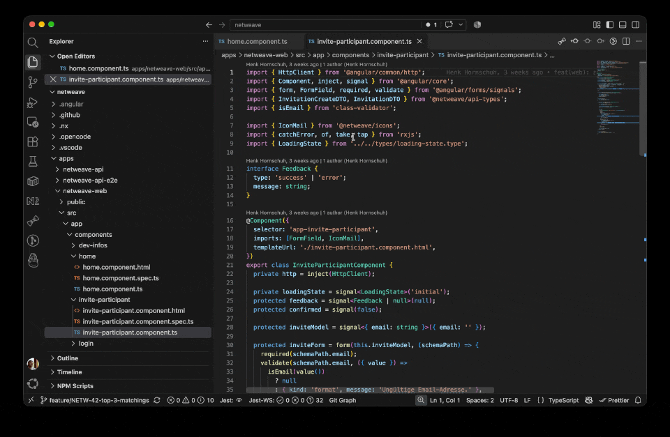

# Tab Grouper for Angular

**Keeps the files of an Angular component next to each other in your tab bar.**

_Normally when you open a file VSCode just appends it to all open tabs on the right._

With this extension when you open a file, it adds **next to to already open files of the same component**.\
The extension looks for open tabs that share the same name up to the first dot and moves the new tab in with them, sorted alphabetically.

```
user-card.component.html   user-card.component.scss   user-card.component.spec.ts   user-card.component.ts
```

Works with both the classic naming (`user-card.component.ts`) and the Angular 20+ style (`user-card.ts`).



## Settings

| Setting | Default | Description |
| --- | --- | --- |
| `angularTabGrouper.sameFolderOnly` | `true` | Only group files from the same folder, so unrelated files like `index.ts` aren't grouped together. |

## Known limitations

- Only newly opened files are placed. Tabs that were already open, or that you drag around yourself, are left alone.
- Pinned tabs and files opened in the background (without focus) are skipped.
- Grouping happens within one editor group (split pane), not across them.

## License

[EUPL-1.2](LICENSE)
